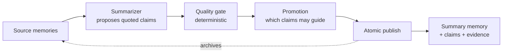

# Compression

Long-running agents accumulate memory faster than a prompt can hold it. Compression
replaces many memories with one summary, and it is built so a summary can never
quietly say something its sources did not.

Two operations use it:

- **`compress_memories`** summarizes memories older than N days for a scope.
- **`auto_summarize_task_stream`** summarizes a TaskStream. It also runs on its own
  (through the TTL worker) when a stream's `total_tokens` passes 80% of its model's
  context budget, unless the stream was created with `auto_summarize: false`.

## How a summary is made



1. The **summarizer** returns claims. Every claim quotes the source text it rests on.
2. The **gate** runs without a second model. Each quote must appear in an input
   source at the version that was read. The claim must say no more, and not the
   opposite, of what its quotes say. The rendered summary must fit the token budget
   and be meaningfully smaller than its inputs. Anything else is rejected, or the
   whole run is deferred.
3. **Promotion** decides which claims are strong enough to act as guidance. Stored
   content is evidence to evaluate, never an instruction.
4. **Publish** is one transaction: it re-checks every source version, writes the
   derivation, summary, claims, evidence and history, and archives the sources. If
   anything fails before the commit, sources and counters are unchanged.

If nothing can be kept safely, the call returns **no summary and changes nothing**.

## Sources are archived, not deleted

Summarized sources get the status `summarized`. They stay readable by ID as
evidence, but every retrieval path filters them out, so a search returns the summary
and not the summary plus its sources.

A summary never has a wider owner than its sources. Sources with different
`user_id`, `agent_id`, `session_id` or scope are not merged.

## Calling it

### MCP

```json
{
  "jsonrpc": "2.0", "id": 4, "method": "tools/call",
  "params": {
    "name": "compress_memories",
    "arguments": { "user_id": "alice", "agent_id": "claude-code", "older_than_days": 30 }
  }
}
```

`older_than_days` is required; `user_id`, `agent_id` and `session_id` narrow the scope.
The result is the published summary memory as JSON, or the text `No memories to
compress`.

```json
{
  "name": "auto_summarize_task_stream",
  "arguments": { "stream_name": "release-1-12", "agent_id": "claude-code", "model_id": "gpt-4o" }
}
```

`model_id` picks the token budget profile (for example `gpt-4o`,
`claude-3-5-sonnet`). Over REST, when it is omitted the stream's own `model_id` is
used, then `default`.

### REST

```bash
curl -s -X POST http://127.0.0.1:3001/api/v1/taskstreams/release-1-12/summarize \
  -H 'content-type: application/json' \
  -d '{"agent_id": "claude-code", "model_id": "gpt-4o"}'
```

The body is optional. Missing fields are taken from the stream.

## Choosing a summarizer

The default is **extractive**: it selects sentences from the sources, makes no network
calls, and labels its output `extractive`. Nothing leaves the process.

A model provider is opt-in because memory text would leave the process. Network
providers need explicit consent, and startup fails without it:

```bash
export SUMMARIZER_PROVIDER=openai_compatible
export SUMMARIZER_EGRESS_ALLOWED=true               # required, or startup fails
export SUMMARIZER_BASE_URL=http://127.0.0.1:4000/v1  # for example a local gateway
export SUMMARIZER_MODEL=gpt-4o-mini
export SUMMARIZER_API_KEY=sk-...                     # optional bearer token
```

Limits you may want to tune (all in [Configuration](../reference/configuration.md#compression-summarizer)):

| Variable | Default | Effect |
|---|---|---|
| `SUMMARIZER_MIN_REDUCTION` | `0.2` | the summary must be at most 80% of the input |
| `SUMMARIZER_MAX_OUTPUT_TOKENS` | `1500` | rendered summary budget |
| `SUMMARIZER_MAX_INPUT_TOKENS` | `32000` | larger inputs are deferred, not truncated |
| `SUMMARIZER_MAX_TOTAL_TOKENS` | `2000000` | spend cap for the process; further calls fail closed |

Source text is sent to a provider as untrusted data, and neither source text nor
provider responses are logged.

## What gets stored

Migrations v22 and v23 add the tables behind this: summary derivations and their
claims, evidence rows linking each claim to its source quote, and the archived-source
status on memories. See [Migrations](../reference/migrations.md).

:::note For library authors
Every retrieval path you add must keep the filter
`(status IS NONE OR status = 'active')`. A path that forgets it returns the archived
sources together with their summary and erases the token savings.
:::
